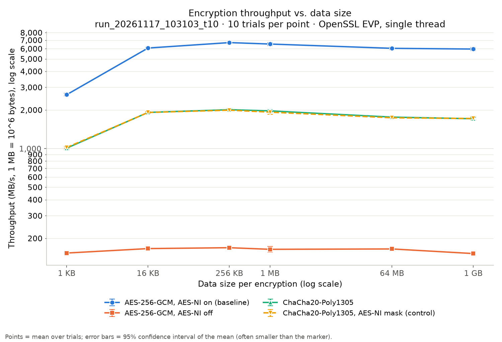

# aesni-bench

**How much does the CPU's AES hardware speed up encryption, and how does AES
compare with a cipher designed for software?**

Computer Systems class project by Ryan Bernabe and Van Vong. We benchmark
AES-256-GCM with the CPU's AES hardware available and hidden, against
ChaCha20-Poly1305. The code is C++17 calling OpenSSL 3.6.5 through its EVP
API, measured on an AMD Ryzen 9 8945HS (Zen 4) laptop under Windows 11.

- Final report: [`docs/REPORT.md`](docs/REPORT.md)
- Analysis: [`docs/ANALYSIS.md`](docs/ANALYSIS.md)

## Headline results

Main run `results/run_20261117_103103_t10.csv`: 4 configurations × 6 sizes ×
10 trials, all 240 trials verified by decryption. Speedups are paired
per-round ratios (mean, 95% CI in `_speedup.csv`).

| | 1 KB | 16 KB | 256 KB | 1 MB | 64 MB | 1 GB |
|---|---|---|---|---|---|---|
| AES-256-GCM, AES hardware **on** (MB/s) | 2,630.7 | 6,071.3 | 6,693.8 | 6,522.7 | 6,039.5 | 5,961.1 |
| AES-256-GCM, AES hardware **off** (MB/s) | 153.6 | 166.4 | 169.0 | 164.2 | 165.3 | 152.2 |
| ChaCha20-Poly1305 (MB/s) | 1,008.3 | 1,913.6 | 2,009.0 | 1,966.5 | 1,759.0 | 1,708.1 |
| **AES hardware on ÷ off** | **17.14×** | **36.52×** | **39.64×** | **39.84×** | **36.58×** | **39.17×** |
| AES-GCM (hardware) ÷ ChaCha20 | 2.61× | 3.17× | 3.33× | 3.32× | 3.44× | 3.49× |

- **AES hardware makes AES-GCM 17× faster for 1 KB messages and 36.5–39.8×
  faster from 16 KB up.**
- With AES hardware, AES-GCM beats ChaCha20-Poly1305 by 2.6–3.5×. Without it,
  ChaCha20 wins by about 6.5–12×.
- The ChaCha20 control is unchanged by the mask: every 95% CI of the with ÷
  without ratio includes 1.00.
- At 16 KB our harness agrees with `openssl speed` within 10% for every configuration.
- The apparent slowdown at 64 MB / 1 GB was mostly a **run-order (thermal)
  artifact**, not a memory wall. See `docs/ANALYSIS.md` §4.



## The configurations

| Config label | Cipher | `OPENSSL_ia32cap` | Role |
|---|---|---|---|
| `aesni_on` | AES-256-GCM | unset | Baseline: hardware AES allowed (on Zen 4 that's VAES + AES-NI) |
| `aesni_off` | AES-256-GCM | `~0x200000200000000:~0x60000000000:~0x0` | All AES hardware hidden; OpenSSL uses bit-sliced SSSE3 AES + table GHASH |
| `chacha_on` | ChaCha20-Poly1305 | unset | Software-oriented cipher (uses AVX-512) |
| `chacha_masked_control` | ChaCha20-Poly1305 | same as `aesni_off` | Control: should match `chacha_on` |
| `aesni_off_fullmask`, `chacha_fullmask` | | `~0x200000200000000` | Diagnostics: our proposal's original mask |

`OPENSSL_ia32cap` makes OpenSSL ignore CPU features. It holds 64-bit
"capability words" separated by `:`, and `~X` means "clear these bits":
- Word 1: bit 57 = AES-NI, bit 33 = PCLMULQDQ.
- Word 2: bit 41 = VAES, bit 42 = VPCLMULQDQ.

**Why not the proposal's `~0x200000200000000`?** We measured two problems:
- OpenSSL 3.6.5 zeroes any word that is left out, so that string also
  disabled AVX2/AVX-512, and ChaCha20 got 2.3× slower.
- On Zen 4, OpenSSL's fastest AES-GCM code uses VAES and ignores the AES-NI
  bit, so hiding AES-NI alone changed nothing.

Details and source references: [`docs/CODE_PATHS.md`](docs/CODE_PATHS.md).

## Reproduce from a fresh clone

### 1. Prerequisites (Windows 10/11, x64)

| Tool | How to get it |
|---|---|
| Visual Studio 2022 with **Desktop development with C++** | Visual Studio Installer (provides `cl`, CMake, Ninja) |
| Git | `winget install --id Git.Git -e` |
| Python 3 + pandas + matplotlib | python.org installer, then `py -m pip install pandas matplotlib` |
| **Standalone vcpkg** (required: the copy bundled with VS 2022 17.14 can no longer build OpenSSL) | see below |

```powershell
git clone https://github.com/microsoft/vcpkg C:\vcpkg
C:\vcpkg\bootstrap-vcpkg.bat -disableMetrics
[Environment]::SetEnvironmentVariable('VCPKG_ROOT', 'C:\vcpkg', 'User')
```

Open a new terminal after setting `VCPKG_ROOT`.

### 2. Clone and build (Release x64), runs the correctness tests too

```powershell
git clone https://github.com/rbernabe2/aesni-bench
cd aesni-bench
.\scripts\build.ps1
```

`build.ps1` does four things:
1. loads the Visual Studio developer shell
2. has vcpkg build OpenSSL 3.6.5 (first time only, about 10 minutes)
3. builds `bench.exe`, `kat.exe` and `method_probe.exe`
4. runs `ctest`: the known-answer tests with no mask, with the `aesni_off`
   mask and with the original mask

All three must say `ALL CORRECTNESS TESTS PASSED`.

Build output goes to `%LOCALAPPDATA%\aesni-bench\build\x64-release`, outside
the repo. `bench.exe` refuses to run if it was built as Debug.

### 3. Prepare the machine (every benchmark session)

1. Plug in the charger (`run_all.ps1` refuses to run on battery).
2. Use the same power / Armoury Crate mode each time, and pass it with `-ArmouryMode`.
3. Close background apps and pause cloud sync.
4. Restart if the machine has been up for days.

### 4. Run the experiment

```powershell
.\scripts\run_all.ps1 -Trials 10 -ArmouryMode Performance   # ~15 min, interleaved rounds
.\scripts\openssl_speed.ps1                                 # ~4 min, cross-check
.\scripts\size_order_check.ps1                              # ~12 min, optional large-size check
.\scripts\collect_env.ps1 -ArmouryMode Performance          # refresh docs\ENVIRONMENT.md
```

Every run writes new timestamped files to `results\`; nothing is overwritten.

### 5. Statistics and graphs

```powershell
py analysis\plot.py                              # newest results\run_*.csv
py analysis\size_check.py results\size_check_<ts>.csv results\run_<ts>_t10.csv
```

`plot.py` writes next to the run's CSV:
- `_stats.md` / `_stats.csv`: mean, SD, CV, min/max, 95% CI, latency, CPU, memory
- `_speedup.csv`
- figures `_fig1` … `_fig7`

### 6. Live demo (about 2–3 minutes)

```powershell
.\scripts\demo.ps1            # press Enter between sections
.\scripts\demo.ps1 -NoPause   # run straight through (about 15 s)
```

The demo shows OpenSSL's capability words with and without the mask, runs
`openssl speed`, the correctness tests and our harness (16 KB and 64 MB,
3 trials each, AES on vs off), shows that every trial verified, and draws a
graph. Output goes to `results\demo\`.

### One configuration by hand

```powershell
$env:OPENSSL_ia32cap = "~0x200000200000000:~0x60000000000:~0x0"     # omit for AES on
& "$env:LOCALAPPDATA\aesni-bench\build\x64-release\bench.exe" --cipher aes-256-gcm --size 16KB --trials 3 --out results\manual.csv --label aesni_off
Remove-Item Env:\OPENSSL_ia32cap
```

## Units

- Data sizes are binary: 1 KB = 1,024 bytes, 1 MB = 2^20, 1 GB = 2^30. Our 1 KB
  and 16 KB tests match `openssl speed`'s 1024 and 16384 block sizes.
- Throughput MB/s uses 1 MB = 1,000,000 bytes, as in `openssl speed`.
- Peak memory MB uses 1 MB = 1,048,576 bytes, as in Task Manager.

## Repository layout

| Path | What it is |
|---|---|
| `src/bench.cpp` | Benchmark harness: one cipher, one size, N trials, one CSV row per trial |
| `src/kat.cpp` | Correctness tests: all 7,875 NIST GCM-256 vectors, RFC 8439 vector, tamper tests |
| `src/method_probe.cpp` | Diagnostic: our per-message method vs `openssl speed`'s |
| `testvectors/` | Official test vector files, with sources and checksums |
| `scripts/build.ps1` | Configure + build + test |
| `scripts/run_all.ps1` | All configs × sizes × trials, interleaved rounds |
| `scripts/openssl_speed.ps1` | `openssl speed` cross-check, mask on/off |
| `scripts/size_order_check.ps1` | Diagnostic: large sizes in shuffled order with cooldowns |
| `scripts/demo.ps1` | Live class demo |
| `scripts/collect_env.ps1` | Writes the hardware/software environment record |
| `scripts/common.ps1` | Shared paths, masks and helpers |
| `scripts/extract_rfc8439_vector.ps1` | Regenerates the RFC 8439 vector from the RFC text |
| `analysis/plot.py` | Statistics, tables and figures |
| `analysis/size_check.py` | Analysis of the size-order check |
| `analysis/demo_plot.py` | Graph for the demo |
| `results/` | All raw CSVs, logs, environment snapshots, statistics and figures (index: `results/README.md`) |
| `docs/REPORT.md` | Final technical report |
| `docs/ANALYSIS.md` | Analysis (measured vs interpretation) |
| `docs/CODE_PATHS.md` | Which OpenSSL code runs in each configuration, with source references |
| `docs/SPEED_COMPARISON.md` | Why small-message results differ from `openssl speed` |
| `docs/ENVIRONMENT.md` | Hardware/software environment of the final run |
| `docs/PROGRESS.md` | Weekly progress log with owners |
