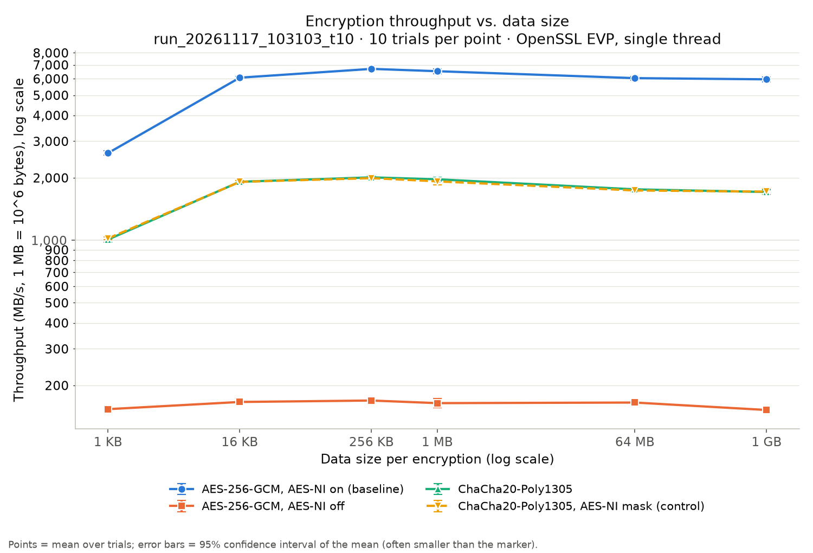
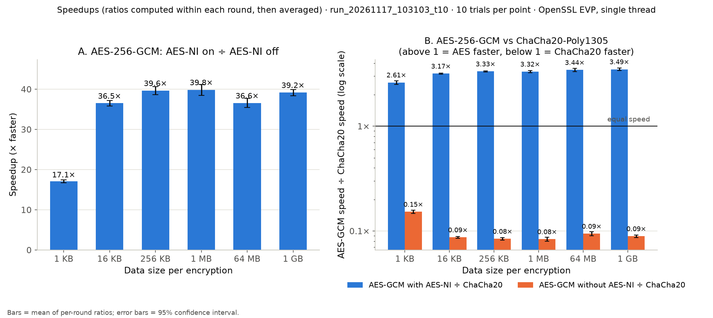
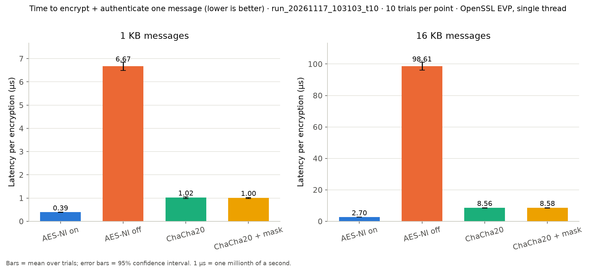
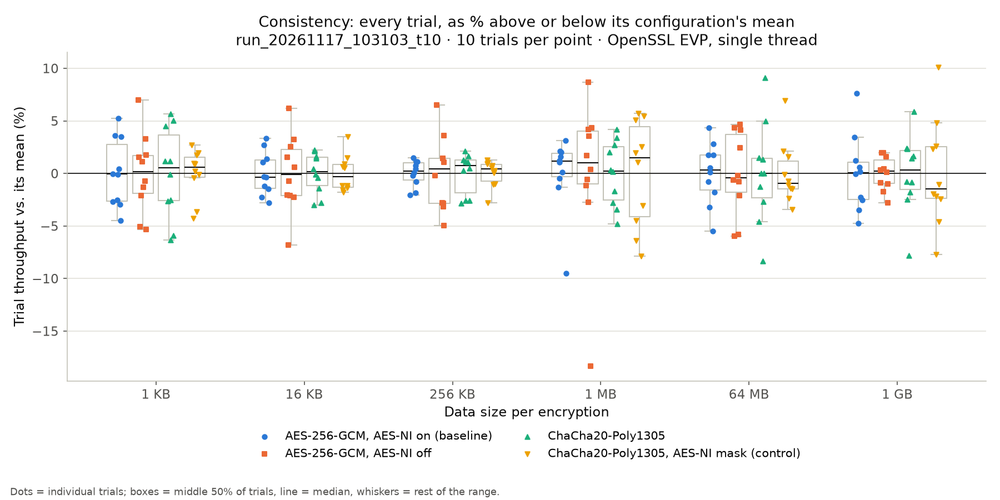
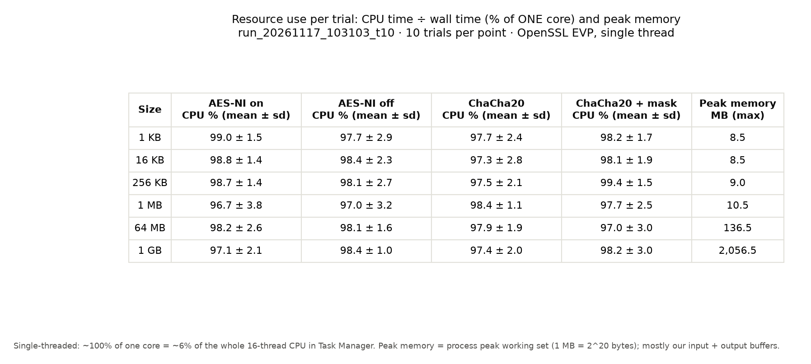
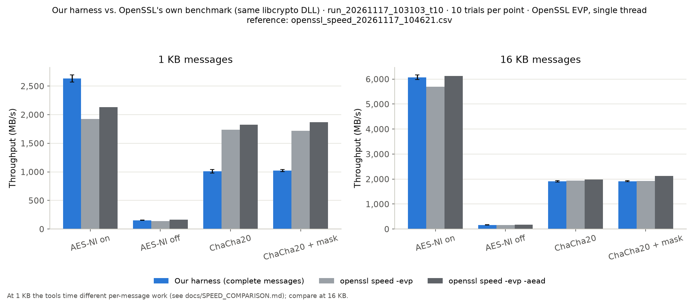
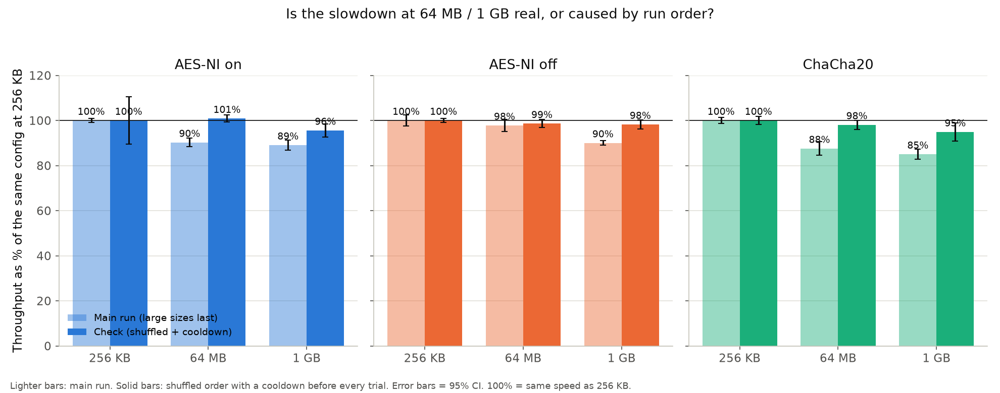

# Benchmarking Hardware-Accelerated Encryption: AES-NI vs Software AES vs ChaCha20-Poly1305

**Ryan Bernabe, Van Vong** · Computer Systems course project · November 2026

All numbers in this report come from files in `results/`. The file is named
next to each result. Detailed statistics: `results/run_20261117_103103_t10_stats.md`.
Full discussion: `docs/ANALYSIS.md`.

---

## 1. Objectives

1. Measure how much the CPU's AES hardware speeds up **AES-256-GCM**
   authenticated encryption, by running the same workload with that hardware
   available and hidden.
2. Compare AES-256-GCM with **ChaCha20-Poly1305**, a cipher designed to be
   fast in software, with and without AES hardware.
3. Explain the results at the system level: dedicated instructions vs software
   fallback vs SIMD, small-message overhead vs bulk throughput, and cache and
   memory effects.
4. Do this with a measurement method we can defend: verified correctness,
   controlled run order, repeated trials and confidence intervals.

## 2. Experimental setup

### Hardware and OS (`docs/ENVIRONMENT.md`, generated by `scripts/collect_env.ps1`)

| Item | Value |
|---|---|
| Machine | ASUS ROG Zephyrus G14 (GA403UV) |
| CPU | AMD Ryzen 9 8945HS (Zen 4), 8 cores / 16 threads, 4.0 GHz base (Windows reports 4001 MHz) |
| Caches (Windows totals) | L1 512 KB, L2 8,192 KB (1 MB per core), L3 16,384 KB |
| CPU crypto features (`bench --info`) | AES-NI, PCLMULQDQ, VAES, VPCLMULQDQ, AVX-512F all present |
| RAM | 15.3 GB usable, 6400 MT/s |
| OS | Windows 11 Home 64-bit, build 26300 |
| Power | AC power, Windows "Performance" plan, Armoury Crate "Performance" mode |

### Software and build

| Item | Value |
|---|---|
| Crypto library | OpenSSL **3.6.5**, built by vcpkg (standalone, registry baseline `91755bb9…`), x64-windows triplet |
| Compiler | MSVC 19.44.35215 (Visual Studio Community 2022 17.14.13), C++17 |
| Build | CMake 3.31.6 + Ninja, **Release x64** (`/O2`); `bench.exe` refuses to run if built as Debug |
| Analysis | Python 3.14.4, pandas, matplotlib |

### Configurations

| Label | Cipher | `OPENSSL_ia32cap` |
|---|---|---|
| `aesni_on` (baseline) | AES-256-GCM | unset |
| `aesni_off` | AES-256-GCM | `~0x200000200000000:~0x60000000000:~0x0` |
| `chacha_on` | ChaCha20-Poly1305 | unset |
| `chacha_masked_control` | ChaCha20-Poly1305 | same mask as `aesni_off` |

`OPENSSL_ia32cap` tells OpenSSL to ignore CPU features when it starts. Our
mask hides exactly four: **AES-NI, PCLMULQDQ, VAES and VPCLMULQDQ**. Our
proposal used `~0x200000200000000`. We changed it after measuring two
problems (`results/README.md`, `docs/CODE_PATHS.md`):

1. OpenSSL 3.6.5 sets any capability word missing from the variable to zero.
   So that string also disabled AVX2/AVX-512, and the ChaCha20 control
   slowed down 2.3×.
2. On Zen 4, OpenSSL's fastest AES-GCM code uses VAES/VPCLMULQDQ and does
   not check the AES-NI bit. Hiding only AES-NI + PCLMULQDQ left AES-GCM at
   full speed.

What actually runs, verified in OpenSSL's source (`docs/CODE_PATHS.md`):

| Config | AES | GHASH / Poly1305 |
|---|---|---|
| `aesni_on` | AVX-512 **VAES** (`aes-gcm-avx512.pl`) | **VPCLMULQDQ** carry-less multiply |
| `aesni_off` | **bit-sliced SSSE3 AES** (`bsaes-x86_64.pl`) + table AES for short tails | **4-bit table** GHASH (`ghash-x86_64.pl`) |
| `chacha_*` | ChaCha20 **AVX-512** (`chacha-x86_64.pl`) | Poly1305 AVX/AVX2/AVX-512 |

### Workload

- Message sizes **1 KB, 16 KB, 256 KB, 1 MB, 64 MB, 1 GB** (1 KB = 1,024 bytes).
- Same random plaintext in every configuration, from a fixed seed.
- 256-bit key, 96-bit nonce, 128-bit tag.
- One complete AEAD message per operation, single-threaded.

## 3. Methodology and implementation

### Correctness first (`src/kat.cpp`)

Before any timing, `kat.exe` checks the two ciphers against official test
vectors that we downloaded rather than typed (`testvectors/README.md`
records the sources and SHA-256 checksums):
- all **7,875 NIST CAVP AES-256-GCM** encryption vectors
- the **RFC 8439 §2.8.2** ChaCha20-Poly1305 vector
- **tamper tests**: a flipped bit in the ciphertext, the tag or the AAD must
  be rejected

`ctest` runs it with no mask, with the `aesni_off` mask and with the
original mask, and all three pass. So every code path we time produces
correct output. We also checked that the test can fail: a corrupted vector
file is reported as FAILED.

### The harness (`src/bench.cpp`), one run = one config × one size

1. **Set-up (not timed).**
   - Allocate input and output buffers and fill the input from the fixed
     seed. The buffers are touched now, so page faults don't land inside
     the timing.
   - Create one OpenSSL `EVP_CIPHER_CTX` and load the key once.
2. **Warm-up (not timed).** Encrypt repeatedly for 0.25 s so caches and the
   CPU clock settle. Use this to estimate the time per encryption, then pick
   the number of iterations that makes a trial last at least 1.0 s. For
   example, 1 KB needed about 2.1–2.6 million iterations and 1 GB with
   `aesni_off` needed 1 (`_stats.md`).
3. **Timed region.** Per iteration:
   - next value of a 96-bit nonce counter (a nonce is never reused)
   - `EVP_EncryptInit_ex2` (new nonce, key kept)
   - `EVP_EncryptUpdate`, `EVP_EncryptFinal_ex`
   - get the 16-byte tag

   Wall time comes from `std::chrono::steady_clock`. CPU time comes from
   Windows `GetProcessTimes` (user + kernel), read just outside the loop.
   There is no I/O, printing or allocation inside the timed region.
4. **Derived values.**
   - throughput = bytes ÷ wall time (1 MB = 10^6 bytes, as in `openssl speed`)
   - latency = wall time ÷ iterations
   - CPU utilisation = CPU time ÷ wall time, as % of one core
   - peak memory = `GetProcessMemoryInfo` peak working set
5. **Verification.** Decrypt the last output in 1 MB chunks, compare it with
   the plaintext and check the tag. The result is recorded as PASS/FAIL in
   the CSV, and a failure prints a large warning.
6. **Output.** One CSV row per trial, including the UTC start and end of the
   timed region.

### Run order and repetitions (`scripts/run_all.ps1`)

- **10 rounds.** Each round runs every size for all four configurations
  **back to back**, and the configuration order is **rotated by one each
  round**. Slow drift (heat, turbo) therefore affects every configuration
  equally.
- 30 s cooldown between rounds, and one `bench.exe` process per trial.
- **240 trials in 14.9 minutes, all verified** (`results/run_20261117_103103_t10.csv`).

### Statistics (`analysis/plot.py`)

- Per config × size: mean, sample SD, coefficient of variation, min/max,
  and a 95% confidence interval using Student's t (n = 10).
- **Speedups are paired.** The ratio is taken within each round, where both
  configs ran back to back, then averaged with its own 95% CI.

### Cross-checks and diagnostics

- **`openssl speed`** uses the same `libcrypto` DLL (hash-checked) and was run
  in the same session (`results/openssl_speed_20261117_104621*`).
- **`method_probe`** explains small-message differences with `openssl speed`
  (`docs/SPEED_COMPARISON.md`).
- **`size_order_check.ps1`** re-measures large sizes in a shuffled order with
  a cooldown before every trial (Section 5.4).

## 4. Results

### 4.1 Throughput



*Figure 1. Mean throughput, 10 trials per point, with 95% CI. A linear-axis
version is `run_20261117_103103_t10_fig1_throughput.png`.*

| Size | aesni_on | aesni_off | chacha_on | chacha_masked_control |
|---|---|---|---|---|
| 1 KB | 2,630.7 ± 61.4 | 153.6 ± 4.1 | 1,008.3 ± 31.2 | 1,021.1 ± 16.8 |
| 16 KB | 6,071.3 ± 89.3 | 166.4 ± 4.3 | 1,913.6 ± 26.2 | 1,911.0 ± 23.3 |
| 256 KB | 6,693.8 ± 59.1 | 169.0 ± 4.2 | 2,009.0 ± 27.5 | 1,992.2 ± 17.9 |
| 1 MB | 6,522.7 ± 167.6 | 164.2 ± 8.5 | 1,966.5 ± 43.4 | 1,922.0 ± 69.8 |
| 64 MB | 6,039.5 ± 126.7 | 165.3 ± 4.6 | 1,759.0 ± 60.9 | 1,737.6 ± 36.6 |
| 1 GB | 5,961.1 ± 154.6 | 152.2 ± 1.7 | 1,708.1 ± 45.0 | 1,714.7 ± 62.5 |

*MB/s, mean ± 95% CI (`_stats.md`).*

### 4.2 Speedups



*Figure 2. A: AES-NI on ÷ off. B: AES-GCM ÷ ChaCha20 with and without AES
hardware (log axis; below 1 means ChaCha20 is faster). Per-round paired
ratios with 95% CI.*

- **AES hardware: 17.14× at 1 KB, 36.52–39.84× from 16 KB to 1 GB** (`_speedup.csv`).
- **AES-GCM with hardware vs ChaCha20: 2.61× (1 KB) to 3.49× (1 GB) faster.**
- **Without AES hardware, ChaCha20 wins**: AES-GCM runs at only 0.083–0.153×
  ChaCha20's speed.

### 4.3 Small messages: latency



*Figure 3. Time per encrypted + authenticated message.*

At 1 KB:

| Config | Latency per message |
|---|---|
| aesni_on | 0.390 µs |
| chacha_on | 1.017 µs |
| aesni_off | 6.675 µs |

A two-point fit through the 16 KB and 256 KB latencies gives a **fixed
per-message cost of 0.269 µs for hardware AES-GCM and 0.434 µs for
ChaCha20-Poly1305** (`_stats.md`).

### 4.4 Consistency and drift



*Figure 4. Every trial as % deviation from its config × size mean.*

- The coefficient of variation is 1.2–7.2% across all 24 config × size cells.
- The largest outlier is one `aesni_off` 1 MB trial, 18.3% below its mean.
- Figure 7 (`run_20261117_103103_t10_fig7_drift.png`) shows no steady drift
  over the 10 rounds. One dip at 1 MB in round 3 hit all four configs at
  once, which points to background activity.

### 4.5 Resource use



*Figure 5. CPU time ÷ wall time (% of one core) and peak memory.*

- **CPU:** 96.7–99.4% of one core on average for every config × size, so the
  harness keeps exactly one core busy (about 6% of the 16-thread CPU).
- **Memory:** peak memory is 2 × message size + about 8.5 MB, the same for
  every cipher (2,056.5 MB at 1 GB).

### 4.6 Agreement with `openssl speed`



*Figure 6. Our harness vs `openssl speed -evp` and `-evp -aead`.*

- **At 16 KB: within 10% for every config.** Ours ÷ `-evp` = 0.987–1.085.
- **At 1 KB they differ by design.** `openssl speed` streams ChaCha20 with no
  per-message nonce or tag, and re-keys AES-GCM every message. A diagnostic
  reproduced both tools within about 6% (`docs/SPEED_COMPARISON.md`).

## 5. Analysis (summary of `docs/ANALYSIS.md`)

### 5.1 Why hardware AES wins by up to 40×

AES is built from byte substitutions and finite-field arithmetic, and GCM's
GHASH needs 128-bit carry-less multiplication. With hardware help these are
single instructions: AES-NI/VAES do a full AES round per instruction (VAES
on several blocks at once), and PCLMULQDQ/VPCLMULQDQ multiply directly.
Without them, OpenSSL must emulate the same maths with logic operations
(bit-sliced AES) and table lookups (4-bit GHASH), and it ran 36.52–39.84×
slower from 16 KB up.

### 5.2 Why ChaCha20 sits in between

ChaCha20 uses only 32-bit add, rotate and xor (ARX), which every CPU does in
one cycle and which vectorises well. OpenSSL runs it on AVX-512, which the
mask does not touch. That's intentional: SIMD is general-purpose hardware.
So ChaCha20 is about 6.5–12× faster than software AES, yet hardware AES-GCM
is 2.61–3.49× faster than ChaCha20.

### 5.3 Small messages

Every message has fixed work: setting the nonce, preparing the
authenticator, finishing it and producing the tag. Hardware makes the
per-byte cost tiny (0.148 ns/byte), so that fixed cost dominates small
messages. Below about 1.8 KB, more than half of hardware AES-GCM's time is
overhead. That's why the AES speedup is 17.14× at 1 KB but 36.52–39.84× from
16 KB up.

### 5.4 Cache effects, and a flaw we found in our own run order

In the main run, `aesni_on` and `chacha_on` were 9.8–15.0% slower at 64 MB
and 1 GB than at 256 KB, and `aesni_off` was 10.0% slower at 1 GB. That
looked like a "memory wall". But software AES also slowed down, at only
152.2 MB/s, so bandwidth could not be the cause. In our rounds the
large sizes always ran last, after the most time under load.



*Figure 8. Large sizes as % of 256 KB speed: main run vs shuffled order with
a cooldown before every trial (`size_check_20261117_105507_summary.md`).*

With the order shuffled and cooled, **64 MB ran at 98.1–100.9% of 256 KB speed,
and 1 GB at 94.9–98.2%**. Most of the drop was heat and turbo, not caches. A
small slowdown at 1 GB remains (for ChaCha20 it lies outside the CIs).
Because it is similar for aesni_on (about 6.3 GB/s) and ChaCha20 (about
1.9 GB/s), we see **no sign of memory bandwidth limiting throughput** on
this machine. The working set streams through the caches and the hardware
prefetchers keep up.

### 5.5 Control

ChaCha20 with ÷ without the mask = 0.978–1.014, and every 95% CI includes
1.00. The mask removed only the AES hardware.

### 5.6 Trade-offs

| Situation | Better choice | Evidence |
|---|---|---|
| CPU with AES hardware | AES-256-GCM | 2.6–3.5× faster here; hardware AES is also constant-time |
| CPU without AES hardware | ChaCha20-Poly1305 | 6.5–12× faster than software AES here; naturally constant-time, unlike table-based AES |
| Very small messages | still AES-GCM (with hardware) | Its edge shrinks to 2.6× at 1 KB, and ChaCha20's per-message overhead is higher |

This is why TLS 1.3 supports both suites.

## 6. Limitations

- **Scope:**
  - one laptop, one OpenSSL version, Windows only, single-threaded
  - CPUs without VAES would show a smaller AES speedup: the classic AES-NI
    path measured 2,102.1 vs 5,695.6 MB/s at 16 KB
- **Thermals:**
  - a laptop's turbo depends on temperature, so absolute numbers shift by
    several percent with heat
  - the main run controlled configuration order but not size order (the
    size check covers this)
- **Measurement tools:**
  - Windows' `% Processor Performance` counter stayed at about 60% of base
    for every trial, so we could not measure the actual clock
  - Windows CPU-time resolution is about 15.6 ms
- **Background and power:**
  - background load before the run was 8.6–15.8% of the whole CPU
  - the battery was charging (78% at the start)
- **What "AES-NI off" means:** OpenSSL's best software path (bit-sliced
  SSSE3 AES), not a CPU without AES hardware or plain C code.
- **ChaCha20 keeps AVX-512.** On CPUs without AVX-512/AVX2 it would be
  slower; our `chacha_fullmask` diagnostic showed about 2.4×.

## 7. Conclusions

1. On this Zen 4 laptop, AES hardware (AES-NI + VAES + carry-less multiply)
   makes AES-256-GCM **17.14× faster for 1 KB messages and 36.52–39.84×
   faster for 16 KB and larger** than OpenSSL's best software implementation.
2. With that hardware, AES-256-GCM beats ChaCha20-Poly1305 by **2.6–3.5×**.
   Without it, ChaCha20-Poly1305 wins by **6.5–12×**, because ARX + SIMD
   needs no special instructions.
3. **Per-message overhead dominates small messages** for hardware AES
   (fixed cost about 0.27 µs, break-even about 1.8 KB), which is why the
   speedup is smaller at 1 KB.
4. Up to 1 GB, single-threaded encryption on this machine is **not limited
   by memory bandwidth**. The apparent slowdown at large sizes was mostly a
   run-order (thermal) artifact, which we found and corrected for.
5. **Method matters:**
   - a "disable AES-NI" switch can silently fail to disable newer AES
     instructions, or disable unrelated SIMD
   - a control configuration and reading the library source are what caught
     both problems

## 8. Individual contributions

Ownership follows our Gantt chart. Dates and tasks are in `docs/PROGRESS.md`.
Commit history is in the repository (`git log`).

| Area | Ryan Bernabe | Van Vong |
|---|---|---|
| Environment setup (toolchain, vcpkg/OpenSSL, `collect_env.ps1`, `ENVIRONMENT.md`) | **Owner** | |
| Correctness validation (`kat.cpp`, official test vectors, tamper tests, mask code-path checks) | **Owner** | |
| AES-NI-off and ChaCha20 configurations (mask design and fixes, control, `openssl_speed.ps1`) | **Owner** | |
| Analysis write-up (`ANALYSIS.md`, `SPEED_COMPARISON.md`, `CODE_PATHS.md`) | **Owner** | |
| Baseline AES-256-GCM benchmark (`bench.cpp` timing loop, warm-up, iterations) | | **Owner** |
| CPU / memory measurement in the harness (`GetProcessTimes`, peak working set) | | **Owner** |
| Statistics and graphs (`plot.py`: CI, CV, paired speedups, figures) | | **Owner** |
| Running trials, final validation, this report, live demo (`demo.ps1`) | **Both** | **Both** |

*Note on tools:* code, scripts and documents in this repository were drafted
with an AI coding assistant (Claude Code) under our direction. Commits from
2026-11-12 onward carry a `Co-Authored-By` line. All measurements were run
on our laptop, and every number traces to a file in `results/`.

## Appendix: reproducing

See `README.md`. In short:

```powershell
.\scripts\build.ps1
.\scripts\run_all.ps1 -Trials 10 -ArmouryMode Performance
.\scripts\openssl_speed.ps1
py analysis\plot.py
```
